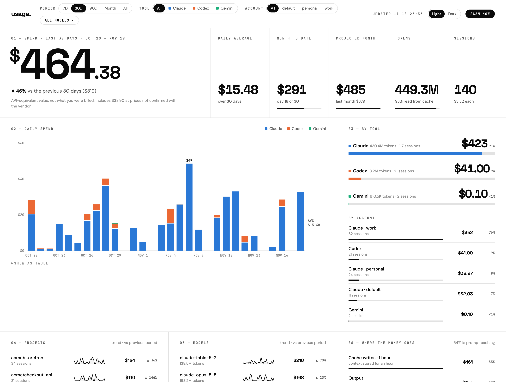

# Claude Code Usage Dashboard

[](LICENSE)
[](https://claude.ai/code)

**Pro and Max subscribers get a progress bar. This gives you the full picture.**

Claude Code writes detailed usage logs locally — token counts, models, sessions, projects — regardless of your plan. This dashboard reads those logs and turns them into charts and cost estimates. Works on API, Pro, and Max plans.



<sub>Screenshot made with invented data.</sub>

**Created by:** [The Product Compass Newsletter](https://www.productcompass.pm)

---

## What this tracks

Works on **API, Pro, and Max plans** — Claude Code writes local usage logs regardless of subscription type. This tool reads those logs and gives you visibility that Anthropic's UI doesn't provide.

Captures usage from:
- **OpenAI Codex CLI** — `~/.codex/sessions/YYYY/MM/DD/rollout-*.jsonl`
- **Gemini CLI** — `~/.gemini/tmp/<project>/chats/session-*.jsonl`
- **Claude Code CLI** (`claude` command in terminal)
- **VS Code extension** (Claude Code sidebar)
- **Dispatched Code sessions** (sessions routed through Claude Code)

**Not captured:**
- **Cowork sessions** — these run server-side and do not write local JSONL transcripts

---

## Requirements

- Python 3.9+
- No third-party packages — uses only the standard library (`sqlite3`, `http.server`, `json`, `pathlib`)

> Anyone running Claude Code already has Python installed.

## Quick Start

No `pip install`, no virtual environment, no build step.

### Windows
```
git clone https://github.com/phuryn/claude-usage
cd claude-usage
python cli.py dashboard
```

### macOS / Linux
```
git clone https://github.com/phuryn/claude-usage
cd claude-usage
python3 cli.py dashboard
```

---

## Usage

> On macOS/Linux, use `python3` instead of `python` in all commands below.

```
# Scan JSONL files and populate the database (~/.claude/usage.db)
python cli.py scan

# Show today's usage summary by model (in terminal)
python cli.py today

# Show all-time statistics (in terminal). Filters: --start --end --source --account --models --json
python cli.py stats

# Check every stored total against the raw logs (exit status 1 on a mismatch)
python cli.py verify

# Scan + open browser dashboard at http://localhost:8080
python cli.py dashboard

# One-time upgrade of an older database (see "Upgrading an older database")
python cli.py migrate --dry-run
python cli.py migrate

# Optional: install a daily scan (macOS launchd). Nothing is scheduled unless you run this.
python cli.py install-schedule
```

---

## The dashboard

The page uses the full width of the window and answers "how much, on what, and is it going up" on one screen:

- **Spend for the period** as the headline, with the change against the previous period of the same length, and beside it the daily average, month to date, projected month, tokens and sessions.
- **What is uncertain**, in words, only when it applies: cost estimated from old history, cost at unverified prices, tokens with no price.
- **Daily spend** in dollars, stacked by tool, with the average line, the peak labelled, a tooltip per day and a table view of the same numbers.
- **By tool and by account**, **projects** and **models** with a trend line per row and the change against the previous period, and **where the money goes** by token category.
- **Sessions** sorted by cost or by recency. Click a Claude session to read its transcript.
- **Click to filter.** Clicking a day in the chart, a tool, an account, a project or a model filters the whole page by it; the active filters are listed at the top and removed with one click. Period, tool, account and model filters are also in the top bar. Everything is kept in the URL.
- **Scan now** re-reads the logs; the page also reloads its data every minute. Days are local calendar days. Light and dark themes.

Colour means one thing only: the tool (Claude, Codex, Gemini). Everything else is monochrome.

The page is three static files in `web/` (`index.html`, `style.css`, `app.js`) with no build step and no chart library. Fonts (Space Grotesk, DM Sans, JetBrains Mono) are loaded from Google Fonts; offline the page falls back to system fonts.

---

## Multi-account setup

If you use Claude Code with multiple accounts (e.g. personal and work), each account needs its own config directory named `.claude-<accountname>` in your home folder.

To add an account, run Claude Code with the `--config-dir` flag pointing to that directory:

```bash
claude --config-dir ~/.claude-personal
claude --config-dir ~/.claude-work
```

The scanner automatically discovers any directory matching `~/.claude-*` that contains a `projects/` subfolder. No extra configuration needed — just run `python3 cli.py scan` and all accounts will be picked up.

The account name shown in the dashboard is derived from the directory name: `~/.claude-personal` → `personal`.

---

## How it works

```
collectors/claude.py ─┐                         prices.json
collectors/codex.py  ─┼─▶ events (SQLite) ─▶ queries.py + pricing.py ─▶ cli.py
collectors/gemini.py ─┘   one row per API response                    └▶ dashboard.py /api/data
        └── reconcile.py checks the stored rows against the raw logs after every scan
```

**One row per API response.** Each tool's log is reduced to one event per response, with a key that is unique per tool, so scanning again can never count something twice:

| Tool | Log location | Key |
|------|--------------|-----|
| Claude Code | `~/.claude/projects/**/*.jsonl`, `~/.claude-*/projects/**/*.jsonl` | `message.id` + `requestId` |
| Codex CLI | `~/.codex/sessions/YYYY/MM/DD/rollout-*.jsonl` | `response_id` (older files: the cumulative total) |
| Gemini CLI | `~/.gemini/tmp/<project>/chats/session-*.jsonl` | message `id` |

Claude Code writes one response as several transcript records, and copies earlier responses into the new file when a session is resumed. Earlier versions of this tool counted every record, which roughly doubled Claude tokens and cost. If your totals dropped by about half after upgrading, that is this correction.

Each event stores uncached input, output, cache read, 5-minute cache write and 1-hour cache write tokens separately, plus model, account, session, project, fast mode and whether it came from a subagent. Session and daily totals are computed from the events when asked for; nothing is accumulated.

**Scanning.** A file whose size and modification time are unchanged is skipped. A changed file is re-read in full and upserted by key. Missing tool directories are skipped.

**Verification.** After every scan, and on `cli.py verify`, stored rows are compared with the logs: Codex against the cumulative totals the log itself records, Gemini against its message ids and token totals, Claude against the distinct responses in each transcript. A file that is still being written is reported as "changed since last scan", not as a mismatch.

**Scan regularly.** Claude Code deletes old transcripts. Anything not scanned before that is gone, which is what `install-schedule` is for.

The database is `~/.claude/usage.db`. Set `CLAUDE_USAGE_DB=/path/to/other.db` to use a different file for any command.

---

## Cost estimates

Cost is the **API-equivalent value** of the usage: what the same tokens would cost at pay-as-you-go API rates. It is not what you were billed. On a Pro, Max, ChatGPT or other subscription you pay a flat fee, and this number tells you how much usage you got for it.

All prices live in [`prices.json`](prices.json), one entry per model with the date it takes effect, the rate for each token category (USD per million tokens), where the number came from, and a `verified` flag. Cost is calculated in one place (`pricing.py`) for both the CLI and the dashboard, at query time, so editing `prices.json` corrects past usage without re-scanning.

- **Verified** entries were read from the vendor's own pages: the Claude models, `gpt-5.4` and `gpt-5.4-mini`.
- **Unverified** entries come from third-party price trackers: `gpt-6-astra`, `gpt-5.6-sol`, `gpt-5.6-luna`, `gpt-5.3-codex`, `gemini-3-flash-preview`, and a few older Claude models. Every total reports how much of it rests on unverified prices.
- **No entry means no cost.** A model that is not in the file shows its tokens and `—` for cost; totals list the tokens that were left out. There is no default rate.
- Claude cache writes are priced by duration (5-minute at 1.25x input, 1-hour at 2x input) and fast-mode responses at the fast rates.
- To add or correct a price, add an entry with a later `effective_from`; older usage keeps the older price.

---

## Upgrading an older database

Databases created before the event model have `turns` and `sessions` tables with double-counted Claude rows. `python cli.py migrate`:

1. copies the database to a working file and builds the `events` table there from the logs on disk;
2. imports sessions whose transcripts no longer exist from the old `turns` table, with the duplicate copies collapsed;
3. verifies the working file against the logs and checks its integrity;
4. prints a before/after table by month and tool;
5. only then saves a backup of the previous file next to it (`usage.db.bak-<timestamp>`) and swaps the new file in.

If any check fails, the live file is not touched. `--dry-run` does steps 1 to 4 and changes nothing. The old tables are kept in the file but no longer used. To roll back, copy the backup over `usage.db`.

Imported old sessions are marked **estimated**: the duplicate removal was exact on every session where it could be compared with a transcript, but it cannot be checked for transcripts that are gone, and those rows have no 5-minute/1-hour cache split (they are priced at the lower 5-minute rate). Totals report how much of the cost is estimated.

---

## Tests

```
python -m unittest
```

Tests run on small synthetic logs in `tests/fixtures/` and temporary databases; they never read your logs or `~/.claude/usage.db`.

---

## Files

| File | Purpose |
|------|---------|
| `collectors/` | One parser per tool: a log file in, a list of events out, no database access |
| `store.py` | Database path, `events` schema, upsert, `event_sessions` view |
| `scanner.py` | `scan()`: finds log files, skips unchanged ones, stores events, runs verification |
| `prices.json`, `pricing.py` | Dated price table and the single cost calculation |
| `queries.py` | Totals and breakdowns with cost, shared by the CLI and the dashboard |
| `reconcile.py` | Stored rows compared with the raw logs |
| `migrate.py` | Legacy import and the copy-verify-swap migration |
| `schedule.py` | Optional daily scan (macOS launchd) |
| `dashboard.py` | HTTP server: `/api/data`, `/api/session`, `POST /api/scan`, and the static page |
| `web/` | The dashboard page (HTML, CSS, JavaScript) |
| `cli.py` | `scan`, `today`, `stats`, `verify`, `migrate`, `install-schedule`, `dashboard` commands |
| `tests/` | Unit tests and synthetic fixtures |
